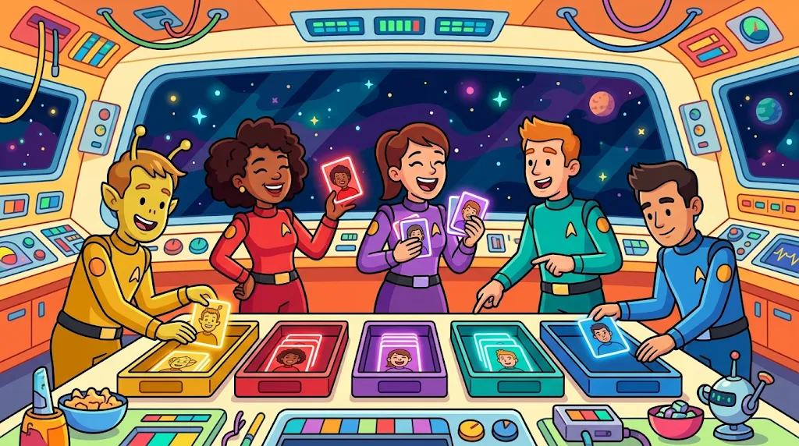

# Starfleet Sorter

A turn-based party game where five friends sort Star Trek characters into their home TV series.

## Play it

https://sarahseti.github.io/starfleet-sorter/

You need one phone or computer to share among 5 players.

## How to play

1. Open the game on one shared screen and tap **Start Game**.
2. Read the Star Trek character name shown on your turn.
3. Tap the button for the TV series that character belongs to.
4. Score 1 point if you guess right on your first try, or keep tapping until you find the match.
5. Play 3 rounds across all 5 players, and the highest score wins.

## Play test log

| Round | Who played | Where they got stuck | What I changed |
| --- | --- | --- | --- |
| 1 | me | Needed a fixed 5-player turn order, visible scores, and the Enterprise series | Set the game to 5 players, kept all scores on screen, and added Enterprise |
| 2 | | | |

## Made with

Built with Gemini in Vibe Coding for Nonprofits, a Whole Whale × Meet the Moment accelerator.
